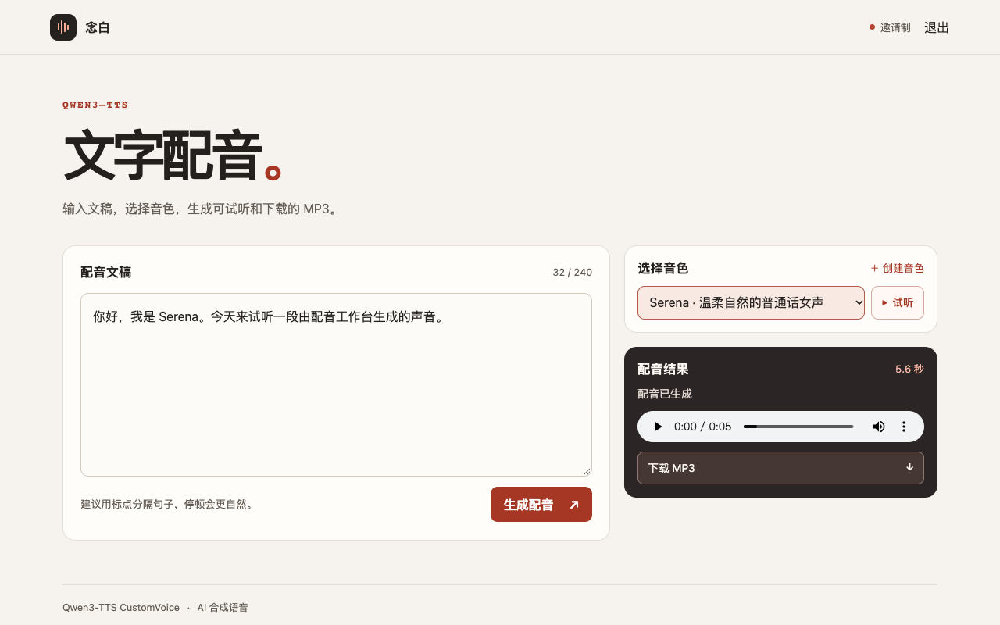

# 念白

**在 Mac 上运行的 AI 配音工作台。** 粘贴文稿，试听九种内置音色，生成并下载 MP3。也可以直接在浏览器录制自己的声音，或用文字设计一个新音色。网页、REST API 和 MCP 共用本地 Qwen3-TTS 推理。

[快速开始](#快速开始) · [使用工作台](#使用工作台) · [REST API](#rest-api) · [MCP](#mcp) · [部署与数据](#部署与数据)



## 功能

| 功能 | 使用方式 |
| --- | --- |
| 文字配音 | 试听并选择 Serena、Vivian 等 9 种预设，覆盖普通话、北京话、四川话、英语、日语和韩语 |
| 声音克隆 | 在浏览器读指定台词，回听录音，再生成克隆样音 |
| 声音设计 | 输入想要的声音描述，或随机生成描述和试听，满意后保存 |
| 私人音色 | 每个邀请身份可以保存 20 个，可复用、试听和删除 |
| 工具集成 | REST API 和 Streamable HTTP MCP 支持查询音色、提交合成、查询状态和取回 MP3 |

## 快速开始

需要 Apple Silicon Mac、macOS 26 或以上、Git、[uv](https://docs.astral.sh/uv/getting-started/installation/) 和包含 `libmp3lame` 的 FFmpeg。完整功能已在 Apple M4、16 GiB 内存的 Mac 上验证。首次安装需要访问 PyPI 和 Hugging Face，之后推理在部署机器运行。

用 [Homebrew](https://brew.sh/) 安装依赖，然后克隆并启动。

```bash
brew install uv ffmpeg
git clone https://github.com/wjd-jax/nianbai.git
cd nianbai

# 安装内置音色，下载约 2.7 GB 模型文件
./scripts/setup
./scripts/start
```

另开一个终端，进入仓库目录并执行以下命令。它将邀请码导出到权限为 `600` 的本机文件，并显示路径。

```bash
.venv/bin/python scripts/manage_access.py export web owner
```

打开 [127.0.0.1:8796](http://127.0.0.1:8796/)，使用该邀请码进入工作台。可以通过 [健康检查](http://127.0.0.1:8796/healthz) 确认模型加载完成。

### 安装私人音色功能

关闭前台进程，安装额外两个模型，再启动服务。使用 `Ctrl+C` 可停止前台进程。

```bash
./scripts/setup --with-private-voices
./scripts/start
```

安装脚本锁定 Python 与依赖版本，并校验模型文件的 SHA-256。模型权重在本地 `assets/` 中保存。三套模型合计约 6.3 GiB，推理时按任务加载所需的一套。

## 使用工作台

1. 输入文稿，选择音色。点击音色旁的「试听」先听样音。
2. 点击「生成配音」。等待完成后可在线播放，并下载 24 kHz 单声道 MP3。
3. 安装私人音色后，点击「创建音色」。可以通过麦克风录制 3–24 秒参考语音，也可以用文字描述或随机设计声音。先试听候选，再取名保存。

音色保存后出现在「私人音色」组。同名网页邀请码与 API Key 可使用同一组私人音色。为每名使用者签发不同名称的凭据，可分隔音色访问权限。录音时请使用自己或已获授权的声音。

## REST API

使用 `.venv/bin/python scripts/manage_access.py export api owner` 导出 API Key。在客户端的请求头中发送 `Authorization: Bearer <API Key>`。

| 请求 | 作用 |
| --- | --- |
| `GET /v1/audio/voices` | 获取可用音色、默认音色和请求限制 |
| `POST /v1/audio/speech` | 提交 `input` 和可选的 `voice`，返回 `202` 和任务状态 |
| `GET /v1/audio/speech/{id}` | 查询 `queued`、`running`、`succeeded` 或 `failed` |
| `GET /v1/audio/speech/{id}/audio` | 下载已完成任务的 MP3 |

以下命令需要 `jq`。先将 API Key 从导出文件读入变量。

```bash
BASE=http://127.0.0.1:8796
VOICE_API_KEY="$(cat .runtime/api-owner.txt)"

TASK=$(curl -fsS "$BASE/v1/audio/speech" \
  -H "Authorization: Bearer $VOICE_API_KEY" \
  -H 'Content-Type: application/json' \
  -d '{"input":"你好，欢迎使用念白。","voice":"serena"}')

STATUS_URL=$(printf '%s' "$TASK" | jq -r '.status_url')
curl -fsS "$BASE$STATUS_URL" -H "Authorization: Bearer $VOICE_API_KEY"
```

约每 2 秒查询一次。状态为 `succeeded` 时，用同一 Key 请求返回的 `audio_url`，例如 `curl -fsS "$BASE$AUDIO_URL" -H "Authorization: Bearer $VOICE_API_KEY" -o speech.mp3`，其中 `AUDIO_URL` 是成功响应中的相对路径。任务满载时返回 `429` 和 `Retry-After`。已过期或当前 Key 无法访问的任务返回 `404`。

## MCP

在支持 **Streamable HTTP** 和自定义请求头的 MCP 客户端中添加服务。本机地址是 `http://127.0.0.1:8796/mcp`。远程客户端填写自己的 HTTPS 域名，路径同样用 `/mcp`。请求头使用 `Authorization: Bearer <API Key>`。

| 工具 | 参数 | 返回 |
| --- | --- | --- |
| `list_voices` | 无 | 当前 Key 可用的音色及服务限制 |
| `generate_speech` | `input`、可选 `voice` | 异步任务 ID。默认音色为 Serena |
| `get_speech_status` | `job_id` | 任务状态。成功后包含可下载的 URL |
| `get_speech_audio` | `job_id` | MP3 音频内容、文件名、时长和下载地址 |

AI 可以按表格顺序完成一次配音。只需下载链接时，在任务成功后读取 `audio_url` 即可。下载请求仍需携带同一 API Key。

## 部署与数据

- **本机常驻**。执行 `.venv/bin/python scripts/launch.py install` 注册当前用户的 macOS LaunchAgent。它在 `~/Library/Application Support/Nianbai` 安装运行副本，用户登录后启动。早期安装会沿用原运行目录。用同一脚本的 `status`、`restart` 和 `stop` 管理服务。安装之前停止占用同一端口的前台实例。
- **远程访问**。用支持 TLS 的反向代理或隧道转发到 `127.0.0.1:8796`。需要开放 MCP 时，将 `VOICE_PUBLIC_HOST` 设为该域名，例如 `VOICE_PUBLIC_HOST=voice.example.com ./scripts/start`。通过 LaunchAgent 安装时也可在 `install` 命令前设置。浏览器在远程录音时需要 HTTPS。
- **凭据与备份**。邀请码只用于网页，API Key 用于 REST 和 MCP。通过 `scripts/manage_access.py` 的 `add`、`rotate` 和 `revoke` 管理凭据，变更后重启服务。备份时一同保管 `.runtime/access.json` 和运行目录的 `.runtime/private-voices.sqlite3`；后者包含已保存音色的参考语音、台词和样音。
- **默认限制**。每条文稿最多 240 个字符，三种入口合计同时生成 1 条、排队 2 条。最近 64 个完成结果在内存中最多保留 30 分钟，重启清空任务与结果。请及时下载需要保留的文件。

## 开发验证

运行 `.venv/bin/python scripts/verify_api.py --full`，可用真实模型验证 HTTP 鉴权、文本限制、共享队列和 MP3。运行 `.venv/bin/python scripts/verify_mcp.py --base http://127.0.0.1:8796 --label mcp-local`，可验证 MCP 工具发现、合成与下载。验证报告保存在本地 `output/`。

## 许可证

项目代码采用 [MIT](LICENSE)。安装脚本从 Hugging Face 获取 [Qwen3-TTS](https://github.com/QwenLM/Qwen3-TTS) 的 [MLX CustomVoice](https://huggingface.co/mlx-community/Qwen3-TTS-12Hz-1.7B-CustomVoice-6bit)、[Base](https://huggingface.co/mlx-community/Qwen3-TTS-12Hz-1.7B-Base-6bit) 和 [VoiceDesign](https://huggingface.co/mlx-community/Qwen3-TTS-12Hz-1.7B-VoiceDesign-6bit) 权重，模型采用 Apache-2.0。推理使用 [MLX Audio](https://github.com/Neywa-Labs/mlx-audio)，MCP 使用 [官方 Python SDK](https://github.com/modelcontextprotocol/python-sdk)。
